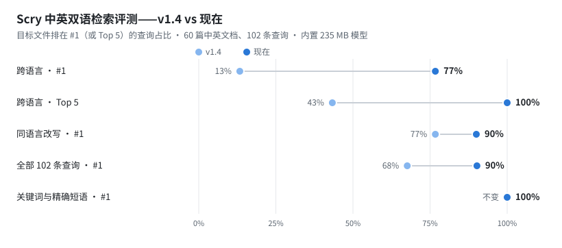

<div align="center">

🌐 [English](README.md) · **简体中文**

# 🔮 Scry

### 用 Scry，按**意思**找到你的文件。

秒级、全盘的**语义**文件搜索，**100% 离线**运行。
按你**记得的意思**去搜——不用记准确的字眼——就能找到文件。你的文件从不离开这台电脑。

`全盘语义搜索 · 秒懂你要找什么 · 纯本地、不联网、隐私零外泄`

**Windows · 100+ 种语言 · 支持 CPU / GPU · 无云端、无账号、无遥测**

### 用中文搜索，找到电脑里的英文 PDF —— 不用记文件名，也不上传文件。

**⬇ [下载 Scry（Windows）](https://github.com/xxx12e/scry/releases/latest)** —— 解压、双击 `.exe` 即用。不装 Python、不用命令行、100% 离线（约 477 MB）。

<sub>未签名的构建，Windows 可能会让你确认一下——介意的话可以核对 <a href="#safe">SHA‑256</a>。</sub>

</div>

---

## 评测成绩

<picture>
  <source media="(prefers-color-scheme: dark)" srcset="docs/img/eval-zh-dark.svg">
  
</picture>

**在 Scry 中英双语检索评测上，Scry 让 90% 的查询把目标文件排在 #1；跨语言查询的 #1 从 13% 提升到 77%，Top 5 达到 100%。**

多语模型天生偏爱和查询同语言的文本，所以在中英混合的文件夹里，相关的英文文件过去常被中文的"长得像"文件压在下面；Scry 现在会在排序前校正这种偏差。逐条比对：102 条查询里 **30 条排名上升、0 条下降**，关键词、精确短语和单语言搜索都没有变差。

| 普通 4 核 CPU，无 GPU | |
|---|---|
| ⚡ **23 ms** 在 **10 万个文本块**里从查询到排好序的结果 | 真实模型端到端实测（ONNX · torch 为 32 ms）；「最佳句」片段随后补上 |
| 🧠 MRR **0.746 → 0.948** | 内置的 **235 MB** 小模型，与 520 MB 的大模型扩展包只差 0.006 |
| 🚀 模型 **约 2 秒**就绪，原来**约 8 秒** | ONNX Runtime——向量完全一致（余弦 0.99999994），不再需要 PyTorch |
| 🔎 BM25 每次查询 **121 ms → 0.3 ms** | 增量倒排索引，分数完全一致；改一个文件不再整体重建 |
| 📦 磁盘占用约**减半** | 不含 torch 的构建：516 MB，v1.4 为 1,026 MB |

<sub>怎么测的、怎么验证我们：评测集（60 篇人工编写的中英文档，每篇都配了"长得像"的干扰文档，共 102 条查询）、全部原始结果和基准脚本都在 [`eval/`](eval/RESULTS.md)；`python scripts/eval.py --model models/embed` 一条命令复现。评测集小、由我们编写，请把它当成"明显更好"的证据，而不是排行榜成绩——最好在你自己的文件夹上试试。以上为当前代码的数据，v1.4 下载包早于这些改进。</sub>

## 用"意思"搜你的文件

你记得**某个文件是讲什么的**。但你记不住它的名字、在五个盘的哪一个、当初写的是"发票"还是"invoice"还是"账单"。关键词搜索恰恰在这里失灵。

**Scry 按意思搜索。** 它的核心是一个**专为语义打造的多语模型**——一个仅 **1.18 亿参数的嵌入网络**，跨 **100+ 种语言**理解*文字到底在说什么*，**而不是**一个几个 GB 的本地大语言模型硬塞进搜索框。它用这个模型对**全盘候选进行毫秒级神经网络重排**；当你要最好的质量时，它还能对你选定的文件夹**建立完整的深度语义索引**——把每一段文字都嵌入向量,于是你搜的"**意思**"能命中那些和你查询词**一个字都不重合**的文件——**甚至跨语言**（用中文搜，也能搜到英文文件，反之亦然）。

一个**真正理解语义的引擎**,不是贴了 AI 标签的关键词匹配——它的模型**只有 235 MB、轻量、100% 跑在你自己的机器上。**

> 这就是 **Everything** 本该进化成的样子：一样的"全盘、即时"手感——但它听得懂你。

## 数据说话

| | |
|---|---|
| ⚡ **23 ms** 在 **10 万个文本块**里出结果——**普通 4 核 CPU** 实测 | 真实模型端到端测量（ONNX；torch 为 32 ms）；每条结果的「最佳句」片段随后补上 |
| 🌐 有 GPU 时**约 0.1 秒**出全盘语义结果（4 核 CPU 首次约 1.5 秒，之后有缓存） | **零预索引**——直接骑系统内容索引 |
| 🪶 **1.18 亿参数 · 235 MB** 多语模型 | 对比其他"AI 搜索"动辄塞的 **4–8 GB** 本地大模型 |
| 🌍 **100+ 种语言 · 跨语言搜索** | 用中文搜、找到英文文件：在 Scry 中英双语检索评测上，跨语言 **#1 达 77%、Top 5 达 100%**（校正前为 13% / 43%）|
| 🔁 GPU 上**约 35 秒**建 10 万文件索引,**约 0.1 秒**重扫 | 增量 diff 实测比全量扫描**快 235×**;4 核 CPU 约 20 块/秒 |
| 🎯 命中**零字面重合**的改写 | 精确 FAISS + BM25 混合,fp16——内存/磁盘减半 |
| 🔒 **0 字节**离开你的电脑 | 全程离线 · 仅监听 `127.0.0.1` · 无账号、无遥测 |
| 📄 **21 种格式**——新旧 Office、**WPS**、**OFD 数电发票**、PDF（开 OCR 后连扫描页也能读）、EPUB、ODF、邮件 · 无需 Docker | 单个 `.exe` · 可选扩展包（DLC）|
| 🖼️ **连图片也能搜** — 可选 OCR | 截图 / 扫描件 / 照片按**意思**搜到 · 系统内置引擎 · **不下载模型** |

<sub>CPU 数据用出货模型在 4 核 2.1 GHz CPU（无 GPU）上实测：10 万块时结果 23 ms 出现（端到端）；20 条结果的语义片段随后在约 0.4–1.5 秒内补齐（取决于文本长度）。建索引的速度最受益于 GPU。详见 [`eval/RESULTS.md`](eval/RESULTS.md)。</sub>

## 一个搜索框，三种搜法

| 模式 | 干什么 | 需要设置 |
|---|---|---|
| 🌐 **全盘语义** | 按意思搜全机器每个文件的**内容**。骑 Windows 内容索引拿候选，再用神经网络按意思重排。 | **不用。** 打开即搜。 |
| ⚡ **文件名** | 像你熟悉的那样，全盘秒搜文件名。 | 不用。 |
| 🎯 **深度语义（掌控模式）** | 指定文件夹（或整个盘），它建**自己的**深度索引——质量最高，能命中**零字面重合**的改写。首次全量扫描，之后只碰有变化的文件，并在后台自动保持最新。 | 每个文件夹点一下。 |

> **第一次用？先选对模式。**「全盘语义」即时、免设置，但它的候选来自 Windows 索引——所以一个**纯改写或跨语言、零字面重合**的查询（正是最能"哇"的那种 demo）在这里可能一条都搜不到。这种就该用「深度语义」：把文件夹掌控一次、建好索引，它就能在**一个字都不重合**时照样命中意思。一句话——**全盘语义 = 广而即时；深度语义 = 意思最深。**

**用大白话筛选。** 在任意搜索后加上 `type:pdf`、`time:上周`、`in:合同`、`after:2024-03`——或者**只写筛选**，比如 `time:上周 type:pdf`，直接按时间倒序列出上周的 PDF。筛选在检索内部生效，条件再窄也不会把结果"筛没"。句子里的时间词（「去年的工作总结」）**不会**被偷偷当成筛选——那份总结多半是今年才写的——Scry 只把它作为一个可一键加上的建议。

**找相似。** 每条结果都有「找相似」按钮：用这个文件自己的意思当查询，在你的深度索引里找出内容最接近的其他文件——哪怕一个词都不重合。

此外：**中英双语界面（一键切换）**、全键盘操作（`回车`搜索、`↑/↓`移动、`回车`打开）、高亮片段直接告诉你**为什么**这个文件匹配，还有一个**免装 Python** 的便携版，在任意 Windows 电脑上双击即用。

**可选扩展包（DLC）。** 基础版保持小巧、100% 离线;重的增强——更大的多语模型、**以文搜图**（「海边日落」，图里不需要有字）、**本地问答**（小模型读文件后作答，出处可点开）——**只在你点击时**才从本仓库下载并校验 SHA‑256——在界面「扩展包」里。

**连图片里的文字也能搜（可选 OCR）。** 在掌控模式里打开 OCR，Scry 就用 **Windows 自带的 OCR 引擎**读出你的**截图、扫描件、照片**里的文字——一张收据截图、一份扫描合同,都能按**意思**被搜到,语言取决于你 Windows 装了哪些 OCR 语言包(大多数机器开箱就有中文 + 英文)。它**不下载任何模型**(引擎和语言数据都由 Windows 提供)、**全程离线**、只给程序加约 4 MB,而且**默认关闭**——打开后点「重新扫描」即可。它的定位是"**找得到**",不是完美转录:花哨或低清的文字可能识别得有点糙,但语义搜索并不在意。

## 它会越用越懂你 —— 在你自己的机器上

你越用，它越贴合你：**你经常打开的文件和文件夹，会在相似的搜索里自动往前排**，并偏向你最近的习惯。这只是温和的重排，并有一条硬规则：常用文件可以从很靠后的位置浮上来，但**绝不会顶掉本次查询的最佳匹配**（除非两者几乎一样相关）；**也绝不劫持一次全新的查询**。而且这是**零代价**的个性化：它只从**你自己的点击**学习、只存在**你自己的磁盘**上，**从不训练模型、也从不把任何东西传出去**。随时可以关掉，或点「忘记我」一键清空。

## 隐私立场（这就是全部意义）

- **只读。** Scry 只会*读*你的文件来建索引——**从不修改、移动、重命名或删除**它们。你的原文件分毫不动。
- **零外联。** 基础版根本不联网：只监听 `127.0.0.1`（连局域网都不开放），模型已内置，也没有服务器可联——无账号、无遥测、无"匿名使用统计"。拔掉网线一切照常。Scry **唯一**一次碰网络，是*你*主动点下载可选扩展包时——从本仓库的 GitHub Releases 下载并校验 SHA‑256。（图片 OCR 用的是本机 Windows API，也不联网。）
- **全程本地存储。** 你的索引和设置存在自己磁盘的 `~/.localsearch_index`；删掉那个文件夹就清空一切。
- **占用很轻。** 纯 CPU（无需显卡）；内置模型约 235 MB，10 万文件的深度索引约 154 MB。全盘语义 / 文件名两种模式完全不建索引。

## 获取（免装 Python）

**[⬇ 下载最新版本](https://github.com/xxx12e/scry/releases/latest)**，解压到任意位置，双击 **`本地语义搜索器.exe`**（或 **`Run 运行.bat`**）。会弹出一个命令行窗口——别关它；几秒后浏览器自动打开搜索界面。就这样：任意 Windows 10/11 电脑、全程离线、无需安装。

<a id="safe"></a>
**安全吗？** 放心，而且不用听我空口——你可以自己核对：

- 这是**未签名**的构建，Windows SmartScreen 可能提示"*已保护你的电脑*"。点 **更多信息 → 仍要运行**。
- **杀软误报是意料之中的。** 这是**未签名、用 PyInstaller 打包**的程序，而 PyInstaller 的引导器是一种字节特征，不少启发式 / ML 杀毒引擎一看到就报——跟代码干什么无关。所以 VirusTotal 上大概率会有 **约 70 个引擎里的几个**报它（通常是些小众引擎，很少是 Microsoft Defender）。对这样打包的正经 Python 程序来说这很正常，**不代表有病毒**。你真正的保障是：**全部开源——自己读，或自己编译出 `.exe`**、上面的 **SHA‑256**、以及它**只读、离线**的行为。想更放心，可以在 **Windows 沙盒（Windows Sandbox）** 里跑。
- 想确认下载到的就是我发布的那个文件——`Scry-v1.4-win64-portable.zip` 的 SHA‑256 是：

```
967e132346c158eaeea8e07871184a39795e73c3d4e7e083a9521c5b9ee21162
```
```powershell
Get-FileHash Scry-v1.4-win64-portable.zip -Algorithm SHA256   # 应与上面一致
```

- 它**只读**你的文件、**从不联网**——见下方 [隐私立场](#隐私立场这就是全部意义)。

**从源码运行（开发者）**

```bash
pip install -r requirements.txt
python -m localsearch.app          # 浏览器打开 http://127.0.0.1:8731
```

或双击 **`run.bat`**（Windows）。打包方法见 [`localsearch/README.md`](localsearch/README.md)。

## 工作原理

```
        你的查询（"那个水库跌到历史最低的文件"）
                              │
        ┌─────────────────────┼───────────────────────────┐
     全盘                   文件名                      深度语义
   (Windows 内容索引)    (Everything 式，MFT 文件名)   (对你选的文件夹建的 FAISS 索引)
        │                                                    │
        └──────────────►  神经网络重排 · Scry 语义模型  ◄──────────┘
                              │
                     排好序的文件 + 精确到命中的那一句，高亮显示
```

- **Scry 语义模型：** 一个仅 **1.18 亿参数的多语嵌入网络**（`multilingual-e5-small`，384 维，**100+ 种语言**），专门用来表示*意思*——不是生成文本的大模型。纯 CPU 可跑、无需显卡，且**从不拿你的文件去训练**。
- **检索：** 精确 FAISS（fp16 标量量化——内存/磁盘减半，仍是穷举精确）+ BM25 词法一臂融合；CJK 感知分块 + 二元组分词，中文文档能被完整搜到。
- **即时模式：** 通过 `Search.CollatorDSO` 直查系统内容索引，再嵌入重排——**零预索引**的全盘内容搜索。
- **稳如老狗：** 索引写入防掉电（fsync + 代号戳，撕裂的保存能被检测并隔离）、退出前自动保存、建索引期间进度条实时刷新且能同时搜索、单线程看护器扛得住批量拷贝。

Scry 是**多语**的——一个模型覆盖 100+ 种语言，所以你能用一种语言搜、找到另一种语言写的文件（中文和英文都是一等公民）。多语模型天生「偏爱同语言」：在中英混合的文件夹里，中文查询过去常把真正相关的英文文件压到后面；Scry 现在在排序前先校正这种偏差（见 `scripts/eval.py`——在自带的中英评测集上总体 MRR 从 0.746 提升到 0.948，单语和精确短语查询不受影响）。评测集小、由人工编写，请把它理解为「明显更好」，而不是跑分。它的目标不是在跑分上击败数据中心，而是给你**云端级的便利 + 零隐私代价**。

## 这一版还有

- **绝不误下云端文件**——OneDrive/Dropbox 的「仅在线」占位文件会被跳过（读取它们会让同步客户端把文件下载下来）。
- **精确到页**——PDF/幻灯片结果显示「第 12 页」，并可「打开到第 12 页」。
- **边打字边出结果**（深度/文件名模式）；明显不相关的结果放到分隔线下并变淡，而不是凑数。
- **「读不了的文件」报告**——扫描后告诉你跳过了什么、怎么解决（例如「7 个扫描版 PDF：开启 OCR」）。
- **桌面模式**（`--window`）：原生窗口、全局热键 **Ctrl+Alt+Space**、托盘图标。
- **不含 torch 的构建**——经 ONNX Runtime 得到完全相同的向量，下载约减半，模型约 1.5 秒就绪；另有 Microsoft Store（MSIX）上架路线：签名、自动更新——见 [`packaging/README.md`](packaging/README.md)。

## 项目结构

```
localsearch/          引擎 + 本地网页界面（这就是产品本体）
  ├─ engine.py        总调度：扫描 → 解析 → 分块 → 嵌入 → 索引 → 搜索
  ├─ index.py         双索引：fp16 FAISS 稠密 + BM25，防掉电持久化
  ├─ bm25.py          增量 BM25（倒排索引；改文件不再整体重建）
  ├─ winsearch.py     "即时全盘"的关键突破（Windows 内容索引）
  ├─ search.py        混合检索 + 最佳句片段
  ├─ watcher.py       防抖后台增量重索引
  ├─ personalize.py   本地、免训练的重排（从你打开过的文件学习）
  ├─ app.py           Flask 后端（仅 127.0.0.1）+ JSON API
  └─ web/index.html   单页界面，双语，零构建步骤
demo_*.py             可直接运行的端到端示例（含 demo_personalize.py）
tests/                pytest 测试（任意系统、无需下载模型）：python -m pytest
run.bat               双击启动
```

## 许可证与致谢

**[PolyForm Noncommercial 1.0.0](LICENSE.md)** —— 可自由用于任何**非商业**目的（个人使用、研究、教育、非营利组织），可自由学习、修改、分享。本许可证**不授予商业使用**；要商用请联系作者。

<sub>Scry 站在优秀的开源之上：嵌入权重来自开源的 **multilingual‑e5** 模型（intfloat，MIT），检索用 **FAISS**（MIT），文件名模式对接 **Everything**（`es.exe`，voidtools，需自行下载）。以上各自遵循其许可。</sub>

---

<div align="center">
<sub>为那些记得<i>写过什么</i>、却忘了<i>放哪儿了</i>的人而做。</sub>
</div>
